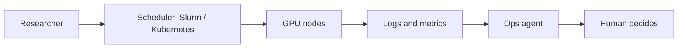

  

I keep big GPU clusters running so researchers can train models instead of fighting infrastructure.

I'm an HPC infrastructure engineer at Microsoft AI. My days are a mix of Kubernetes, Slurm, Terraform, and working out why a job that ran fine yesterday is stuck today.

## What I'm good at

  

  
  
  

- **GPU cluster operations:** scheduling, quotas, node health, networking and storage for large training jobs
- **Kubernetes and Slurm:** running both, and debugging the places where they disagree
- **Infrastructure as code:** Terraform and GitOps with Argo CD, so changes are reviewed and repeatable
- **Observability:** Datadog, Grafana and Kusto, used to find a root cause rather than decorate a dashboard
- **Tooling:** Python and Go, mostly small tools that remove a manual step someone was doing at 2 a.m.
- **AI agents for operations:** agents that investigate failures and propose fixes, with humans deciding what ships

## Work I'm proud of

Most of what I build lives in private repos, so here it is in words.

| 🤖 Support agent | 🧠 Multi-agent engineering | 🔍 Failure investigation |
|---|---|---|
| Answers cluster users in Slack, digs through logs and metrics when a job fails, and proposes improvements to its own knowledge that a person accepts or refuses. | Coordinators plan the work, workers implement it in isolated worktrees, and reviewers from a different model family check every change before it merges. | Ties a failed training job to a cause, whether that is the node, the network, storage or the scheduler, and backs each claim with a query result. |

## How it fits together

## What I'm working on now

- Making operations agents trustworthy enough to carry real on-call work
- Bringing new GPU capacity into service without surprising the people already training on it

## Get in touch

I'm always happy to talk about GPU infrastructure, scheduling, or agents that do operations work.
